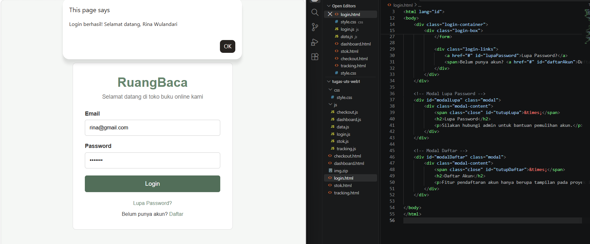
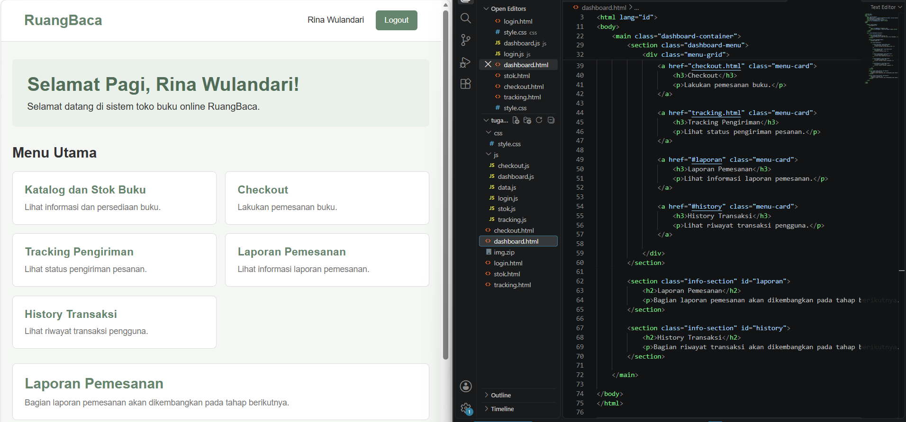
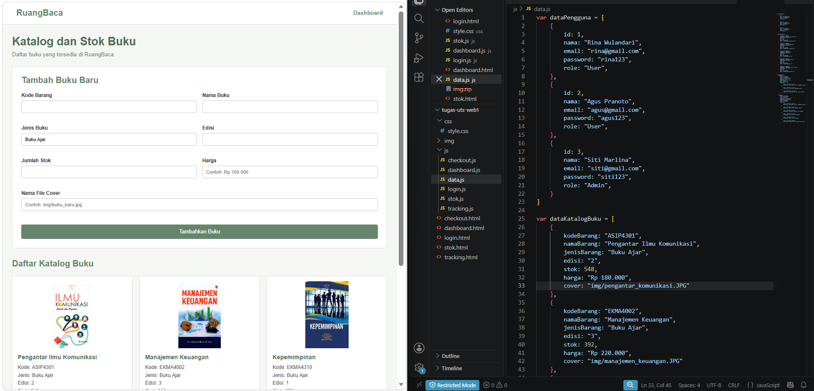
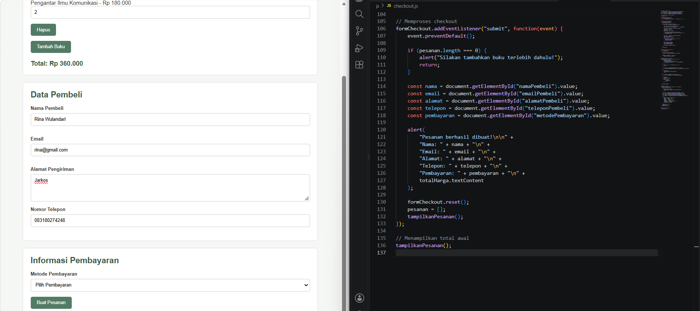
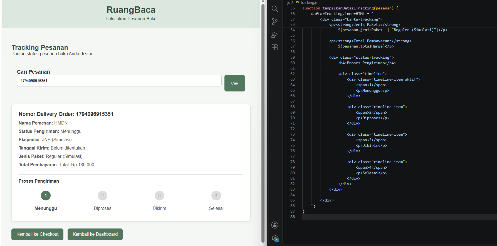

# RuangBaca – Aplikasi Toko Buku Online

## 1. Deskripsi Proyek

**RuangBaca** merupakan aplikasi toko buku online sederhana yang dikembangkan untuk memenuhi tugas Ujian Tengah Semester (UTS) mata kuliah **Pemrograman Web 1**.

Aplikasi ini dirancang untuk memberikan gambaran proses pemesanan buku secara online, mulai dari melihat katalog dan informasi stok buku, melakukan pemesanan, menyelesaikan checkout, hingga melacak status pengiriman.

Aplikasi dikembangkan menggunakan HTML, CSS, dan JavaScript dengan penyimpanan data menggunakan Local Storage pada browser.

## 2. Identitas Mahasiswa

| Keterangan | Informasi |
|---|---|
| Nama | Yusuf Hamdani |
| NIM | 312510049 |
| Program Studi | Teknik Informatika |
| Mata Kuliah | Pemrograman Web 1 |
| Nama Aplikasi | RuangBaca |

## 3. Tujuan Pembuatan

Tujuan pembuatan aplikasi RuangBaca adalah menerapkan materi yang telah dipelajari dalam mata kuliah Pemrograman Web 1 ke dalam sebuah proyek sederhana.

Melalui proyek ini, beberapa konsep yang diterapkan meliputi:
- Penggunaan struktur HTML yang semantik.
- Pengaturan tampilan menggunakan CSS.
- Manipulasi elemen HTML menggunakan JavaScript DOM.
- Penggunaan event dan interaksi pengguna.
- Validasi form dan penggunaan alert.
- Pengelolaan data menggunakan Array dan Local Storage.

## 4. Teknologi yang Digunakan

| Teknologi | Kegunaan |
|---|---|
| HTML5 | Membuat struktur halaman aplikasi. |
| CSS3 | Mengatur tampilan dan tata letak aplikasi. |
| JavaScript | Mengatur logika, interaksi, dan manipulasi DOM. |
| Local Storage | Menyimpan data pengguna dan riwayat pemesanan pada browser. |

## 5. Fitur Aplikasi

Berikut merupakan fitur utama yang tersedia pada aplikasi RuangBaca:

### A. Login
Halaman untuk pengguna masuk ke aplikasi menggunakan email dan password. Terdapat validasi untuk memeriksa data login.

### B. Dashboard
Halaman utama yang menampilkan sapaan pengguna berdasarkan waktu serta navigasi menuju fitur-fitur aplikasi.

### C. Katalog dan Stok Buku
Menampilkan informasi buku, seperti kode barang, nama buku, jenis buku, edisi, harga, dan jumlah stok. Data katalog ditampilkan menggunakan JavaScript.

### D. Checkout
Fitur untuk memilih buku, mengatur jumlah pesanan, menghapus buku dari daftar pesanan, serta mengisi informasi pembeli dan metode pembayaran.

### E. Tracking Pengiriman
Fitur untuk mencari pesanan berdasarkan Nomor Delivery Order (DO) dan melihat informasi serta status pesanan.

### F. Laporan Pemesanan dan History Transaksi
Menampilkan daftar pemesanan dan riwayat transaksi yang tersimpan di Local Storage.

## 6. Struktur Folder Proyek

Berikut merupakan struktur folder utama aplikasi RuangBaca:

```text
UTS_Pemrograman_Web1/
│
├── index.html
├── dashboard.html
├── stok.html
├── checkout.html
├── tracking.html
│
├── css/
│   └── style.css
│
├── js/
│   ├── data.js
│   ├── login.js
│   ├── dashboard.js
│   ├── stok.js
│   ├── checkout.js
│   └── tracking.js
│
├── img/
│
├── Screenshot/
│   ├── ss1.png
│   ├── ss2.png
│   ├── ss3.png
│   ├── ss4.png
│   ├── ss5.png
│   └── ss6.png
│
└── README.md
```

## 7. Cara Menjalankan Aplikasi

Untuk menjalankan aplikasi RuangBaca, ikuti langkah berikut:

1. Download atau clone repository proyek ke komputer.
2. Buka folder proyek menggunakan Visual Studio Code.
3. Pastikan seluruh file HTML, CSS, JavaScript, dan folder pendukung berada pada struktur yang sesuai.
4. Jalankan file `index.html` melalui browser atau menggunakan ekstensi Live Server pada Visual Studio Code.
5. Aplikasi RuangBaca siap digunakan.

**Catatan:** Aplikasi ini merupakan simulasi toko buku online berbasis front-end dan belum menggunakan database maupun sistem pembayaran sungguhan.

## 8. Dokumentasi Tampilan Aplikasi

Berikut merupakan dokumentasi hasil pengerjaan aplikasi RuangBaca.

### 1. Halaman Login

Halaman awal aplikasi yang digunakan pengguna untuk masuk ke sistem RuangBaca.



### 2. Dashboard

Halaman utama yang menampilkan informasi pengguna dan menu navigasi aplikasi.



### 3. Katalog dan Stok Buku

Halaman yang menampilkan daftar buku beserta informasi dan persediaan stok.



### 4. Form Checkout

Halaman untuk melakukan pemesanan buku dengan mengisi informasi pembeli dan metode pembayaran.



### 5. Tracking Pengiriman

Halaman untuk mencari dan melihat informasi status pengiriman berdasarkan Nomor Delivery Order.



### 6. Hasil Akhir Aplikasi

Dokumentasi tampilan akhir aplikasi RuangBaca setelah fitur-fitur utama selesai dikembangkan.


## 9. Penutup

Melalui pembuatan aplikasi RuangBaca, diharapkan materi yang telah dipelajari dalam mata kuliah Pemrograman Web 1 dapat diterapkan secara langsung ke dalam sebuah proyek sederhana.

Proyek ini juga menjadi sarana untuk memahami bagaimana HTML, CSS, dan JavaScript bekerja sama dalam membangun sebuah aplikasi web yang interaktif dan memiliki fungsi sesuai kebutuhan.

---

**Dibuat oleh:** Yusuf Hamdani  
**NIM:** 312510049  
**Program Studi:** Teknik Informatika